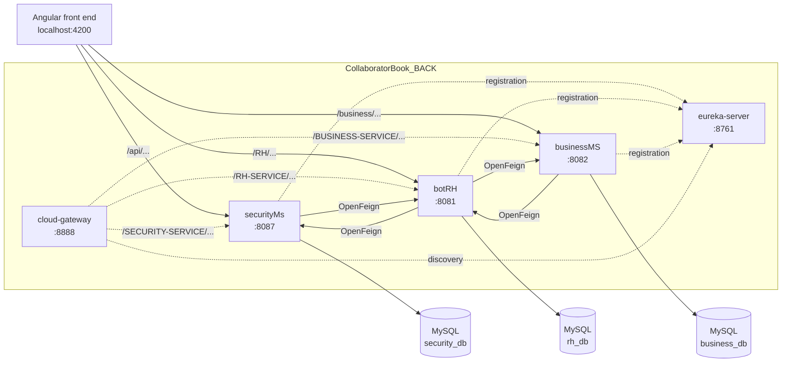

# CollaboratorBook — back end (Spring Boot microservices)

[Français](README.md) · **English**

Back end of CollaboratorBook, an internal social network and HR platform for companies: five Spring Boot applications
(Eureka registry, gateway, JWT security, HR, company structure) and three MySQL databases. End-of-studies project built
at DITRIOT Consulting (2022–2023), updated in 2026 (security, dependencies).

Angular front end: [CollaboratorBook_FRONT](https://github.com/rachedchakchouk/CollaboratorBook_FRONT).
Detailed documentation: [architecture](docs/ARCHITECTURE.en.md) · [API](docs/API.en.md) · [data model](docs/DATA-MODEL.en.md).

## Overview

- **Company sign-up**: a single request creates the company, its head office (`header_office`), an "Administration"
  department, a "Manager" job, the manager's employee record and their administrator account.
- **Authentication**: username and password sign-in (BCrypt), a JWT access token valid for 10 minutes and a refresh
  token.
- **HR** (`botRH`): employees, contracts (CDI, CDD, CIVP, internship) and clauses, leave requests (approval, balance of
  1.8 days per month of contract), projects, documents (upload and download), posts, comments, notifications and claims.
- **Company structure** (`businessMS`): companies, offices, departments and jobs.
- **Soft archiving**: most resources have an `archived` field, `archive` / `noarchive` routes and "active" and
  "archived" lists.
- **OpenAPI documentation**: Swagger UI on each of the three business services.

## Tech stack

Versions read from the `pom.xml` files of the five modules.

| Layer | Technology | Version |
|---|---|---|
| Language | Java (`java.version`, compiler `source` / `target`) | 1.8 |
| Framework | Spring Boot (parent POM) | 2.7.18 |
| Microservices | Spring Cloud (BOM): Netflix Eureka, Gateway, OpenFeign | 2021.0.9 |
| Pinned patch versions | Spring Framework · Spring Security · embedded Tomcat | 5.3.39 · 5.7.14 · 9.0.123 |
| Persistence | Spring Data JPA (Hibernate) · `com.mysql:mysql-connector-j` driver | managed by Spring Boot · 8.4.0 |
| Security | Spring Security (securityMs) · `com.auth0:java-jwt` | 5.7.14 · 3.19.4 |
| DTO mapping | MapStruct | 1.6.3 |
| Code generation | Lombok | managed by Spring Boot |
| API documentation | `org.springdoc:springdoc-openapi-ui` | 1.8.0 |
| Build | Maven Wrapper in each module | Maven 3.8.4 (3.8.5 for securityMs) |
| Database | MySQL | not specified in the repository |

## Architecture



| Module | Port | Eureka name (`spring.application.name`) | Database | Responsibility |
|---|---|---|---|---|
| `eureka-server` | 8761 | — | — | Netflix Eureka service registry |
| `cloud-gateway` | 8888 | `gateway-service` | — | Spring Cloud Gateway: discovery-based routes, CORS |
| `securityMs` | 8087 | `security-service` | `security_db` | Users, roles, sign-in, JWT tokens |
| `botRH` | 8081 | `rh-service` | `rh_db` | Employees, contracts, clauses, leave, projects, documents, posts, comments, notifications, claims |
| `businessMS` | 8082 | `business-service` | `business_db` | Companies, offices, departments, jobs |

- The current front end calls securityMs, botRH and businessMS **directly** on their ports; the gateway URLs are still
  in its services but commented out.
- The gateway has no static route (the `gatewayRoutes` bean is commented out): it is configured to expose each service
  under its upper-case Eureka ID, for example `http://localhost:8888/RH-SERVICE/RH/employees`. However, its `pom.xml`
  adds `spring-webmvc` next to `spring-cloud-starter-gateway`, and Spring Cloud Gateway, which is reactive, rejects
  Spring MVC on the classpath: the gateway needs fixing before it can be used.
- The services call each other with OpenFeign, using Eureka names (`RH-SERVICE`, `SECURITY-SERVICE`,
  `BUSINESS-SERVICE`), so Eureka must be running for these calls to succeed.
- Each business service follows a `controller` → `service` → `repo` (Spring Data JPA) layering, with request and
  response DTOs converted by MapStruct.

Detailed flows (company sign-up, sign-in): [docs/ARCHITECTURE.en.md](docs/ARCHITECTURE.en.md).

## Repository layout

There is no parent POM: each module is a standalone Maven project with its own wrapper.

```text
CollaboratorBook_BACK/
├── eureka-server/           # Eureka registry (:8761)
├── cloud-gateway/           # Spring Cloud Gateway (:8888)
├── securityMs/              # security (:8087)
│   └── src/main/java/com/ditriot/securityms/
│       ├── controller/      # UserController (/api)
│       ├── filter/          # CustomAuthenticationFilter (POST /api/login), CustomAuthorizationFilter (Bearer)
│       ├── security/        # SecurityConfig, CORSFilter, JwtAlgorithm (reads JWT_SECRET)
│       └── model/, repo/, service/
├── botRH/                   # HR and social network (:8081)
│   └── src/main/java/com/ditriot/
│       ├── controller/      # REST controllers under /RH
│       ├── dto/, mapper/    # request / response DTOs, MapStruct mappers
│       ├── model/           # JPA entities and enums
│       ├── repo/            # Spring Data JPA repositories
│       └── service/         # business logic and OpenFeign clients (JobService, UserService)
├── businessMS/              # company structure (:8082)
│   └── src/main/java/com/detiriot/businessms/   # same layering as botRH
├── docs/                    # architecture, API, data model (FR / EN)
├── .github/dependabot.yml   # weekly Maven updates
├── .env.example             # environment variable names
└── LICENSE
```

Each module also contains `src/main/resources/application.properties` and a test in `src/test/java/.../*ApplicationTests.java`.

## Prerequisites

- JDK 8 to 21: the modules are compiled for Java 8 and Spring Boot 2.7.18 is compatible up to Java 21.
- A MySQL server on `localhost:3306` (the address is hard-coded in the `application.properties` files), with an account
  allowed to create databases.
- Access to Maven Central on the first run: the wrapper downloads Maven and the dependencies. Maven itself does not need
  to be installed.
- For the full application: the [CollaboratorBook_FRONT](https://github.com/rachedchakchouk/CollaboratorBook_FRONT)
  front end (Node.js).

## Running locally

### 1. Get the code

```bash
git clone https://github.com/rachedchakchouk/CollaboratorBook_BACK.git
cd CollaboratorBook_BACK
```

### 2. Set the environment variables

Spring Boot does not read `.env` files: `.env.example` only lists the names. Set the variables in every terminal that
starts a service (or in the IDE run configuration). `JWT_SECRET` is only used by securityMs; `DB_USERNAME` and
`DB_PASSWORD` are used by securityMs, botRH and businessMS.

Windows (PowerShell):

```powershell
$bytes = New-Object byte[] 48
[System.Security.Cryptography.RandomNumberGenerator]::Create().GetBytes($bytes)
$env:JWT_SECRET = [Convert]::ToBase64String($bytes)
$env:DB_USERNAME = "root"
$env:DB_PASSWORD = "<MySQL password>"
```

Linux / macOS:

```bash
export JWT_SECRET=$(openssl rand -base64 48)
export DB_USERNAME=root
export DB_PASSWORD='<MySQL password>'
```

Keep the same `JWT_SECRET` value between runs: a token signed with another key is rejected.

### 3. Start the services

Start each module in its own terminal, Eureka first. The three business services can start in any order. The gateway
(`cloud-gateway`) is not needed by the current front end (see Architecture).

Windows (PowerShell), from the repository root:

```powershell
cd eureka-server; .\mvnw.cmd spring-boot:run   # terminal 1
cd securityMs;    .\mvnw.cmd spring-boot:run   # terminal 2 (JWT_SECRET, DB_USERNAME, DB_PASSWORD)
cd botRH;         .\mvnw.cmd spring-boot:run   # terminal 3 (DB_USERNAME, DB_PASSWORD)
cd businessMS;    .\mvnw.cmd spring-boot:run   # terminal 4 (DB_USERNAME, DB_PASSWORD)
```

Linux / macOS: the `mvnw` scripts are not marked executable in the repository; run them with `sh` (or run
`chmod +x */mvnw` once).

```bash
cd eureka-server && sh mvnw spring-boot:run    # then securityMs, botRH and businessMS, each in its own terminal
```

| Access | URL |
|---|---|
| Eureka dashboard | http://localhost:8761 |
| securityMs Swagger UI | http://localhost:8087/swagger-ui.html |
| botRH Swagger UI | http://localhost:8081/swagger-ui.html |
| businessMS Swagger UI | http://localhost:8082/swagger-ui.html |

### 4. Create the roles (once)

The `CommandLineRunner` that used to create the roles is commented out in `SecurityMsApplication`, yet
`UserServiceImpl` looks roles up by name when it creates an account: create them before the first sign-up so that
accounts get their roles. Create them only once: the `role` table has no uniqueness constraint and `findByName` would
fail on a duplicate.

```powershell
foreach ($role in "ADMIN", "RH", "EMPLOYEE", "SUPER_USER", "ROBOT") {
  Invoke-RestMethod -Method Post -Uri http://localhost:8087/api/role/save -ContentType "application/json" -Body (@{ name = $role } | ConvertTo-Json)
}
```

```bash
for role in ADMIN RH EMPLOYEE SUPER_USER ROBOT; do
  curl -s -X POST http://localhost:8087/api/role/save -H "Content-Type: application/json" -d "{\"name\":\"$role\"}"
done
```

### 5. Start the front end and create the first account

1. Start the front end (`npm ci` then `npm start`, see its README): http://localhost:4200.
2. Register a company from the `/signup` page (or with `POST /business/Companies/newCompany`). The manager becomes an
   administrator.
3. Sign in at http://localhost:4200: the username is the manager's e-mail address and the initial password is their
   first name (botRH applies this rule to every new employee).

## Configuration

### Environment variables

| Variable | Module(s) | Purpose | Default |
|---|---|---|---|
| `JWT_SECRET` | securityMs | HMAC-SHA256 key used to sign and verify JWTs, at least 32 characters, read by `JwtAlgorithm` on each use | none: the service starts, but `POST /api/login` fails |
| `DB_USERNAME` | securityMs, botRH, businessMS | MySQL user (`spring.datasource.username`) | `root` |
| `DB_PASSWORD` | securityMs, botRH, businessMS | MySQL password (`spring.datasource.password`) | empty |

### `application.properties` keys

One file per module, no Spring profiles.

| Key | Value in the repository |
|---|---|
| `server.port` | 8761, 8888, 8087, 8081, 8082 (see Architecture) |
| `spring.application.name` | `gateway-service`, `security-service`, `rh-service`, `business-service` |
| `eureka.client.service-url.defaultZone` | `http://localhost:8761/eureka` (clients); the Eureka server does not register itself |
| `spring.datasource.url` | `jdbc:mysql://localhost:3306/<database>?createDatabaseIfNotExist=true&useSSL=false&serverTimezone=UTC` |
| `spring.jpa.hibernate.ddl-auto` | `update` |
| `spring.jpa.show-sql` | `true` |
| `spring.jpa.properties.hibernate.dialect` | `MySQL8Dialect` (securityMs), `MySQL5Dialect` (botRH, businessMS) |
| `spring.servlet.multipart.max-file-size` / `max-request-size` | `200MB` / `215MB` (botRH) |
| `spring.mvc.pathmatch.matching-strategy` | `ant_path_matcher` |
| `spring.cloud.gateway.discovery.locator.enabled` | `true` (cloud-gateway) |
| `spring.cloud.gateway.globalcors.corsConfigurations.[/**].*` | origin `http://localhost:4200/`, credentials allowed, all methods and headers (cloud-gateway) |

## Database

- **Engine**: MySQL. Three databases are created on first start thanks to `createDatabaseIfNotExist=true`:
  `security_db` (securityMs), `rh_db` (botRH), `business_db` (businessMS).
- **Schema**: generated and updated by Hibernate (`ddl-auto=update`). There is no Flyway or Liquibase.
- **Demo data**: none. Roles are created by hand (step 4); the first employee and their account are created by a company
  sign-up.
- **Cross-database references**: links from one service to another are plain ID columns without foreign keys (for
  example `employee.job_id` in `rh_db` pointing to `job` in `business_db`).

Entities, relationships and enums: [docs/DATA-MODEL.en.md](docs/DATA-MODEL.en.md).

## API

No route requires authentication or a role on the server side (see Security). Full list of routes:
[docs/API.en.md](docs/API.en.md); Swagger UI: `/swagger-ui.html` on each business service.

| Service | Prefix | Main routes |
|---|---|---|
| securityMs (8087) | `/api` | `POST /api/login`, `GET /api/token/refresh`, `GET /api/employee/{username}`, `POST /api/user/save`, `POST /api/role/save` |
| botRH (8081) | `/RH` | `/RH/employees`, `/RH/contracts`, `/RH/clauses`, `/RH/holidays`, `/RH/projects`, `/RH/documents`, `/RH/post`, `/RH/comment`, `/RH/notifications`, `/RH/Reclamations` |
| businessMS (8082) | `/business` | `POST /business/Companies/newCompany`, `/business/Companies`, `/business/offices`, `/business/Departments`, `/business/jobs` |

Sign-in example (form parameters):

```bash
curl -X POST http://localhost:8087/api/login -d "username=<e-mail>" -d "password=<password>"
```

## Tests

Each module contains a single test, `contextLoads()` (`@SpringBootTest`), which checks that the Spring context starts.

```powershell
cd botRH; .\mvnw.cmd test
```

```bash
cd botRH && sh mvnw test
```

For securityMs, botRH and businessMS, this test opens the MySQL connection, so the database must be reachable. No
workflow runs these tests automatically.

## Build, CI and deployment

- **Build**: `mvnw package` in a module produces an executable JAR (`spring-boot-maven-plugin`) in `target/`, for
  example `target/botRH-0.0.1-SNAPSHOT.jar`, to run with `java -jar`.
- **CI**: no GitHub Actions workflow.
- **Dependabot** (`.github/dependabot.yml`): Maven ecosystem on the five modules, every Monday at 06:00
  (Africa/Tunis), at most five open PRs, `deps` prefix, `dépendances` label. Updates are grouped (security, Spring,
  other minor and patch updates); major versions of Spring Boot, Spring Cloud and springdoc are ignored.
- **Deployment**: no Dockerfile, Docker Compose file or hosting configuration in the repository.

## Security

- **Sign-in**: `POST /api/login` (`username` and `password` parameters) goes through `CustomAuthenticationFilter` and
  the Spring Security `AuthenticationManager` (BCrypt-hashed passwords). The JSON response contains `access_Token`,
  `refresh_token`, `username` and `roles`.
- **Tokens**: JWTs signed with HMAC256 using `JWT_SECRET`. The access token (claims `sub`, `roles`, `iss`, `exp`)
  expires after 10 minutes; the refresh token (no `roles`) expires after 365 hours. `GET /api/token/refresh` issues a new access token from
  the refresh token.
- **Roles**: `ADMIN`, `RH`, `EMPLOYEE`, `SUPER_USER`, `ROBOT` (`role` table). The user's `role` field (`ADMIN`,
  `HUM_RES`, `EMPLOYEE`, `SUPER_USER`, `BOT`) determines the roles granted at creation; an `ADMIN` gets `ADMIN`, `RH`
  and `EMPLOYEE`.
- **Authorization**: no route is protected on the server side. In `SecurityConfig`, the only active rule is
  `antMatchers("/*").permitAll()` (`anyRequest().authenticated()` is commented out), and botRH and businessMS do not
  include Spring Security. When an `Authorization: Bearer` header is present, securityMs verifies the token and answers
  with a JSON error message if it is invalid. Access control is done by the front end (route guard).
- **CORS**: `@CrossOrigin("*")` on every controller; securityMs's `CORSFilter` adds `Access-Control-Allow-Origin: *`;
  the gateway allows the `http://localhost:4200/` origin.
- **Accounts created by botRH**: username = work e-mail address, initial password = first name; no route lets users
  change it.
- **Secrets**: the JWT key and the MySQL credentials come from environment variables; `.env` is ignored by Git.

## License

All rights reserved: the code is published for review as part of a portfolio. See [LICENSE](LICENSE).

## Author

**Rached Chakchouk** — Full Stack Software Engineer (Java / Spring Boot / Angular)
[LinkedIn](https://www.linkedin.com/in/rached-chakchouk) · [Portfolio](https://rached-chakchouk.netlify.app)
