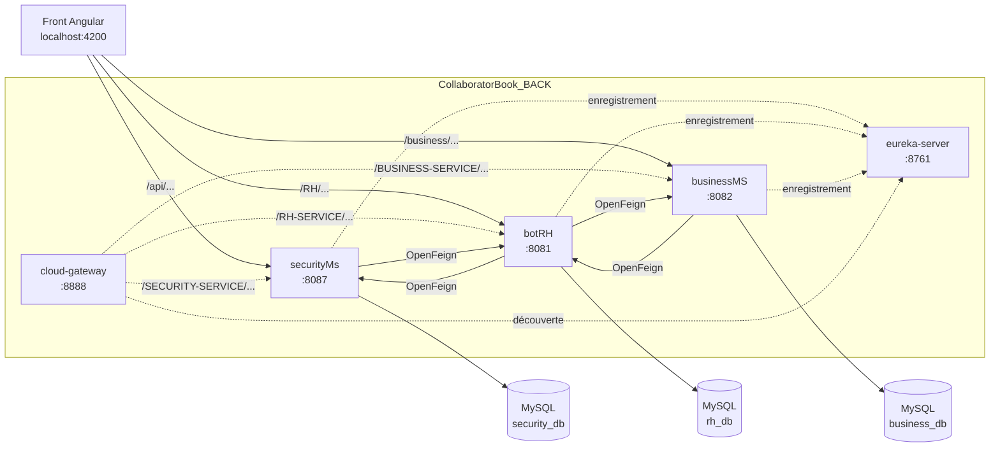

# CollaboratorBook — back-end (microservices Spring Boot)

**Français** · [English](README.en.md)

Back-end de CollaboratorBook, réseau social interne et plateforme RH pour les entreprises : cinq applications
Spring Boot (registre Eureka, passerelle, sécurité JWT, RH, structure de l'entreprise) et trois bases MySQL.
Projet de fin d'études réalisé chez DITRIOT Consulting (2022–2023), mis à jour en 2026 (sécurité, dépendances).

Front-end Angular : [CollaboratorBook_FRONT](https://github.com/rachedchakchouk/CollaboratorBook_FRONT).
Documentation détaillée : [architecture](docs/ARCHITECTURE.md) · [API](docs/API.md) · [modèle de données](docs/DATA-MODEL.md).

## Aperçu

- **Inscription d'une entreprise** : une seule requête crée l'entreprise, son siège (`header_office`), un département
  « Administration », un poste « Manager », la fiche du gérant et son compte administrateur.
- **Authentification** : connexion par identifiant et mot de passe (BCrypt), jeton d'accès JWT valable 10 minutes et
  jeton de rafraîchissement.
- **RH** (`botRH`) : employés, contrats (CDI, CDD, CIVP, stage) et clauses, demandes de congé (validation, solde de
  1,8 jour par mois de contrat), projets, documents (téléversement et téléchargement), publications, commentaires,
  notifications et réclamations.
- **Structure de l'entreprise** (`businessMS`) : entreprises, bureaux, départements et postes.
- **Archivage logique** : la plupart des ressources ont un champ `archived`, des routes `archive` / `noarchive` et des
  listes « actives » et « archivées ».
- **Documentation OpenAPI** : Swagger UI sur chacun des trois services métier.

## Stack technique

Versions lues dans les `pom.xml` des cinq modules.

| Couche | Technologie | Version |
|---|---|---|
| Langage | Java (`java.version`, `source` / `target` du compilateur) | 1.8 |
| Framework | Spring Boot (POM parent) | 2.7.18 |
| Microservices | Spring Cloud (BOM) : Netflix Eureka, Gateway, OpenFeign | 2021.0.9 |
| Correctifs imposés | Spring Framework · Spring Security · Tomcat embarqué | 5.3.39 · 5.7.14 · 9.0.123 |
| Persistance | Spring Data JPA (Hibernate) · pilote `com.mysql:mysql-connector-j` | géré par Spring Boot · 8.4.0 |
| Sécurité | Spring Security (securityMs) · `com.auth0:java-jwt` | 5.7.14 · 3.19.4 |
| Mapping DTO | MapStruct | 1.6.3 |
| Code généré | Lombok | géré par Spring Boot |
| Documentation d'API | `org.springdoc:springdoc-openapi-ui` | 1.8.0 |
| Build | Maven Wrapper dans chaque module | Maven 3.8.4 (3.8.5 pour securityMs) |
| Base de données | MySQL | non précisée dans le dépôt |

## Architecture



| Module | Port | Nom Eureka (`spring.application.name`) | Base | Rôle |
|---|---|---|---|---|
| `eureka-server` | 8761 | — | — | Registre de services Netflix Eureka |
| `cloud-gateway` | 8888 | `gateway-service` | — | Passerelle Spring Cloud Gateway : routes créées par découverte, CORS |
| `securityMs` | 8087 | `security-service` | `security_db` | Utilisateurs, rôles, connexion, jetons JWT |
| `botRH` | 8081 | `rh-service` | `rh_db` | Employés, contrats, clauses, congés, projets, documents, publications, commentaires, notifications, réclamations |
| `businessMS` | 8082 | `business-service` | `business_db` | Entreprises, bureaux, départements, postes |

- Le front actuel appelle **directement** securityMs, botRH et businessMS sur leurs ports ; les URL passant par la
  passerelle sont présentes mais commentées dans ses services.
- La passerelle n'a pas de route statique (le bean `gatewayRoutes` est commenté) : elle est configurée pour exposer
  chaque service sous son identifiant Eureka en majuscules, par exemple `http://localhost:8888/RH-SERVICE/RH/employees`.
  Son `pom.xml` ajoute toutefois `spring-webmvc` à `spring-cloud-starter-gateway`, alors que Spring Cloud Gateway,
  réactif, refuse Spring MVC sur le classpath : la passerelle est à corriger avant tout usage.
- Les services s'appellent entre eux avec OpenFeign, par nom Eureka (`RH-SERVICE`, `SECURITY-SERVICE`,
  `BUSINESS-SERVICE`) : Eureka doit donc tourner pour que ces appels aboutissent.
- Chaque service métier suit le découpage `controller` → `service` → `repo` (Spring Data JPA), avec des DTO de requête
  et de réponse convertis par MapStruct.

Flux détaillés (inscription d'une entreprise, connexion) : [docs/ARCHITECTURE.md](docs/ARCHITECTURE.md).

## Structure du dépôt

Il n'y a pas de POM parent : chaque module est un projet Maven autonome, avec son propre wrapper.

```text
CollaboratorBook_BACK/
├── eureka-server/           # registre Eureka (:8761)
├── cloud-gateway/           # passerelle Spring Cloud Gateway (:8888)
├── securityMs/              # sécurité (:8087)
│   └── src/main/java/com/ditriot/securityms/
│       ├── controller/      # UserController (/api)
│       ├── filter/          # CustomAuthenticationFilter (POST /api/login), CustomAuthorizationFilter (Bearer)
│       ├── security/        # SecurityConfig, CORSFilter, JwtAlgorithm (lecture de JWT_SECRET)
│       └── model/, repo/, service/
├── botRH/                   # RH et réseau social (:8081)
│   └── src/main/java/com/ditriot/
│       ├── controller/      # contrôleurs REST sous /RH
│       ├── dto/, mapper/    # DTO de requête / réponse, mappers MapStruct
│       ├── model/           # entités JPA et énumérations
│       ├── repo/            # dépôts Spring Data JPA
│       └── service/         # logique métier et clients OpenFeign (JobService, UserService)
├── businessMS/              # structure de l'entreprise (:8082)
│   └── src/main/java/com/detiriot/businessms/   # même découpage que botRH
├── docs/                    # architecture, API, modèle de données (FR / EN)
├── .github/dependabot.yml   # mises à jour Maven hebdomadaires
├── .env.example             # noms des variables d'environnement
└── LICENSE
```

Chaque module contient aussi `src/main/resources/application.properties` et un test `src/test/java/.../*ApplicationTests.java`.

## Prérequis

- Un JDK de 8 à 21 : les modules sont compilés en Java 8 et Spring Boot 2.7.18 est compatible jusqu'à Java 21.
- Un serveur MySQL sur `localhost:3306` (adresse écrite dans les `application.properties`), avec un compte autorisé à
  créer des bases.
- Un accès à Maven Central au premier lancement : le wrapper télécharge Maven et les dépendances. Maven n'a pas besoin
  d'être installé.
- Pour l'application complète : le front [CollaboratorBook_FRONT](https://github.com/rachedchakchouk/CollaboratorBook_FRONT)
  (Node.js).

## Installation et lancement en local

### 1. Récupérer le code

```bash
git clone https://github.com/rachedchakchouk/CollaboratorBook_BACK.git
cd CollaboratorBook_BACK
```

### 2. Définir les variables d'environnement

Spring Boot ne lit pas de fichier `.env` : `.env.example` donne seulement les noms. Définissez les variables dans chaque
terminal qui lance un service (ou dans la configuration d'exécution de l'IDE). `JWT_SECRET` ne concerne que securityMs ;
`DB_USERNAME` et `DB_PASSWORD` concernent securityMs, botRH et businessMS.

Windows (PowerShell) :

```powershell
$bytes = New-Object byte[] 48
[System.Security.Cryptography.RandomNumberGenerator]::Create().GetBytes($bytes)
$env:JWT_SECRET = [Convert]::ToBase64String($bytes)
$env:DB_USERNAME = "root"
$env:DB_PASSWORD = "<mot de passe MySQL>"
```

Linux / macOS :

```bash
export JWT_SECRET=$(openssl rand -base64 48)
export DB_USERNAME=root
export DB_PASSWORD='<mot de passe MySQL>'
```

Utilisez la même valeur de `JWT_SECRET` d'un lancement à l'autre : un jeton signé avec une autre clé est refusé.

### 3. Démarrer les services

Lancez chaque module dans son propre terminal, en commençant par Eureka. L'ordre des trois services métier est libre.
La passerelle (`cloud-gateway`) n'est pas nécessaire au front actuel (voir Architecture).

Windows (PowerShell), depuis la racine du dépôt :

```powershell
cd eureka-server; .\mvnw.cmd spring-boot:run   # terminal 1
cd securityMs;    .\mvnw.cmd spring-boot:run   # terminal 2 (JWT_SECRET, DB_USERNAME, DB_PASSWORD)
cd botRH;         .\mvnw.cmd spring-boot:run   # terminal 3 (DB_USERNAME, DB_PASSWORD)
cd businessMS;    .\mvnw.cmd spring-boot:run   # terminal 4 (DB_USERNAME, DB_PASSWORD)
```

Linux / macOS : les scripts `mvnw` ne sont pas marqués exécutables dans le dépôt ; appelez-les avec `sh` (ou lancez une
fois `chmod +x */mvnw`).

```bash
cd eureka-server && sh mvnw spring-boot:run    # puis securityMs, botRH et businessMS, chacun dans son terminal
```

| Accès | URL |
|---|---|
| Tableau de bord Eureka | http://localhost:8761 |
| Swagger UI securityMs | http://localhost:8087/swagger-ui.html |
| Swagger UI botRH | http://localhost:8081/swagger-ui.html |
| Swagger UI businessMS | http://localhost:8082/swagger-ui.html |

### 4. Créer les rôles (une seule fois)

Le `CommandLineRunner` qui créait les rôles est commenté dans `SecurityMsApplication`. Or `UserServiceImpl` cherche
les rôles par leur nom au moment de créer un compte : créez-les avant la première inscription pour que les comptes
reçoivent leurs rôles. Créez-les une seule fois : la table `role` n'impose pas l'unicité et `findByName` échouerait sur
un doublon.

```powershell
foreach ($role in "ADMIN", "RH", "EMPLOYEE", "SUPER_USER", "ROBOT") {
  Invoke-RestMethod -Method Post -Uri http://localhost:8087/api/role/save -ContentType "application/json" -Body (@{ name = $role } | ConvertTo-Json)
}
```

```bash
for role in ADMIN RH EMPLOYEE SUPER_USER ROBOT; do
  curl -s -X POST http://localhost:8087/api/role/save -H "Content-Type: application/json" -d "{\"name\":\"$role\"}"
done
```

### 5. Lancer le front et créer le premier compte

1. Démarrez le front (`npm ci` puis `npm start`, voir son README) : http://localhost:4200.
2. Inscrivez une entreprise depuis la page `/signup` (ou `POST /business/Companies/newCompany`). Le gérant devient
   administrateur.
3. Connectez-vous sur http://localhost:4200 : l'identifiant est l'e-mail du gérant et le mot de passe initial son
   prénom (règle appliquée par botRH à chaque création d'employé).

## Configuration

### Variables d'environnement

| Variable | Module(s) | Rôle | Valeur par défaut |
|---|---|---|---|
| `JWT_SECRET` | securityMs | Clé HMAC-SHA256 de signature et de vérification des JWT, 32 caractères au moins, lue par `JwtAlgorithm` à chaque usage | aucune : le service démarre, mais `POST /api/login` échoue |
| `DB_USERNAME` | securityMs, botRH, businessMS | Utilisateur MySQL (`spring.datasource.username`) | `root` |
| `DB_PASSWORD` | securityMs, botRH, businessMS | Mot de passe MySQL (`spring.datasource.password`) | vide |

### Clés de `application.properties`

Un seul fichier par module, sans profil Spring.

| Clé | Valeur dans le dépôt |
|---|---|
| `server.port` | 8761, 8888, 8087, 8081, 8082 (voir Architecture) |
| `spring.application.name` | `gateway-service`, `security-service`, `rh-service`, `business-service` |
| `eureka.client.service-url.defaultZone` | `http://localhost:8761/eureka` (clients) ; le serveur Eureka ne s'enregistre pas lui-même |
| `spring.datasource.url` | `jdbc:mysql://localhost:3306/<base>?createDatabaseIfNotExist=true&useSSL=false&serverTimezone=UTC` |
| `spring.jpa.hibernate.ddl-auto` | `update` |
| `spring.jpa.show-sql` | `true` |
| `spring.jpa.properties.hibernate.dialect` | `MySQL8Dialect` (securityMs), `MySQL5Dialect` (botRH, businessMS) |
| `spring.servlet.multipart.max-file-size` / `max-request-size` | `200MB` / `215MB` (botRH) |
| `spring.mvc.pathmatch.matching-strategy` | `ant_path_matcher` |
| `spring.cloud.gateway.discovery.locator.enabled` | `true` (cloud-gateway) |
| `spring.cloud.gateway.globalcors.corsConfigurations.[/**].*` | origine `http://localhost:4200/`, identifiants autorisés, toutes méthodes et en-têtes (cloud-gateway) |

## Base de données

- **Moteur** : MySQL. Trois bases créées au premier démarrage grâce à `createDatabaseIfNotExist=true` : `security_db`
  (securityMs), `rh_db` (botRH), `business_db` (businessMS).
- **Schéma** : généré et mis à jour par Hibernate (`ddl-auto=update`). Il n'y a ni Flyway ni Liquibase.
- **Données de démonstration** : aucune. Les rôles se créent à la main (étape 4) ; le premier employé et son compte
  naissent de l'inscription d'une entreprise.
- **Références entre bases** : les liens d'un service à l'autre sont de simples colonnes d'identifiant, sans clé
  étrangère (par exemple `employee.job_id` dans `rh_db` vers `job` dans `business_db`).

Entités, relations et énumérations : [docs/DATA-MODEL.md](docs/DATA-MODEL.md).

## API

Aucune route n'exige d'authentification ni de rôle côté serveur (voir Sécurité). Liste complète des routes :
[docs/API.md](docs/API.md) ; Swagger UI : `/swagger-ui.html` sur chaque service métier.

| Service | Préfixe | Principales routes |
|---|---|---|
| securityMs (8087) | `/api` | `POST /api/login`, `GET /api/token/refresh`, `GET /api/employee/{username}`, `POST /api/user/save`, `POST /api/role/save` |
| botRH (8081) | `/RH` | `/RH/employees`, `/RH/contracts`, `/RH/clauses`, `/RH/holidays`, `/RH/projects`, `/RH/documents`, `/RH/post`, `/RH/comment`, `/RH/notifications`, `/RH/Reclamations` |
| businessMS (8082) | `/business` | `POST /business/Companies/newCompany`, `/business/Companies`, `/business/offices`, `/business/Departments`, `/business/jobs` |

Exemple de connexion (paramètres de formulaire) :

```bash
curl -X POST http://localhost:8087/api/login -d "username=<e-mail>" -d "password=<mot de passe>"
```

## Tests

Chaque module contient un seul test, `contextLoads()` (`@SpringBootTest`), qui vérifie que le contexte Spring démarre.

```powershell
cd botRH; .\mvnw.cmd test
```

```bash
cd botRH && sh mvnw test
```

Pour securityMs, botRH et businessMS, ce test ouvre la connexion MySQL : la base doit être accessible. Aucun workflow
ne lance ces tests automatiquement.

## Build, CI et déploiement

- **Build** : `mvnw package` dans un module produit un JAR exécutable (`spring-boot-maven-plugin`) dans `target/`,
  par exemple `target/botRH-0.0.1-SNAPSHOT.jar`, à lancer avec `java -jar`.
- **CI** : aucun workflow GitHub Actions.
- **Dependabot** (`.github/dependabot.yml`) : écosystème Maven sur les cinq modules, chaque lundi à 06:00
  (Africa/Tunis), cinq PR ouvertes au plus, préfixe `deps`, label `dépendances`. Les mises à jour sont groupées
  (sécurité, Spring, autres mineures et correctives) ; les versions majeures de Spring Boot, Spring Cloud et springdoc
  sont ignorées.
- **Déploiement** : ni Dockerfile, ni Docker Compose, ni configuration d'hébergement dans le dépôt.

## Sécurité

- **Connexion** : `POST /api/login` (paramètres `username` et `password`) passe par `CustomAuthenticationFilter` et
  l'`AuthenticationManager` de Spring Security (mots de passe hachés en BCrypt). La réponse JSON contient
  `access_Token`, `refresh_token`, `username` et `roles`.
- **Jetons** : JWT signés en HMAC256 avec `JWT_SECRET`. Le jeton d'accès (claims `sub`, `roles`, `iss`, `exp`) expire
  après 10 minutes ; le jeton de rafraîchissement (sans `roles`) expire après 365 heures. `GET /api/token/refresh` émet un nouveau
  jeton d'accès à partir du jeton de rafraîchissement.
- **Rôles** : `ADMIN`, `RH`, `EMPLOYEE`, `SUPER_USER`, `ROBOT` (table `role`). Le champ `role` de l'utilisateur
  (`ADMIN`, `HUM_RES`, `EMPLOYEE`, `SUPER_USER`, `BOT`) fixe les rôles attribués à la création ; un `ADMIN` reçoit
  `ADMIN`, `RH` et `EMPLOYEE`.
- **Autorisation** : aucune route n'est protégée côté serveur. Dans `SecurityConfig`, seule la règle
  `antMatchers("/*").permitAll()` est active (`anyRequest().authenticated()` est commentée), et botRH et businessMS
  n'intègrent pas Spring Security. Si un en-tête `Authorization: Bearer` est présent, securityMs vérifie le jeton et
  répond par un message d'erreur JSON s'il est invalide. Le contrôle d'accès est fait par le front (garde de route).
- **CORS** : `@CrossOrigin("*")` sur tous les contrôleurs ; `CORSFilter` de securityMs ajoute
  `Access-Control-Allow-Origin: *` ; la passerelle autorise l'origine `http://localhost:4200/`.
- **Comptes créés par botRH** : identifiant = e-mail professionnel, mot de passe initial = prénom ; aucune route ne
  permet de le changer.
- **Secrets** : la clé JWT et les identifiants MySQL viennent de variables d'environnement ; `.env` est ignoré par Git.

## Licence

Tous droits réservés : le code est publié pour consultation dans le cadre d'un portfolio. Voir [LICENSE](LICENSE).

## Auteur

**Rached Chakchouk** — ingénieur logiciel Full Stack (Java / Spring Boot / Angular)
[LinkedIn](https://www.linkedin.com/in/rached-chakchouk) · [Portfolio](https://rached-chakchouk.netlify.app)
