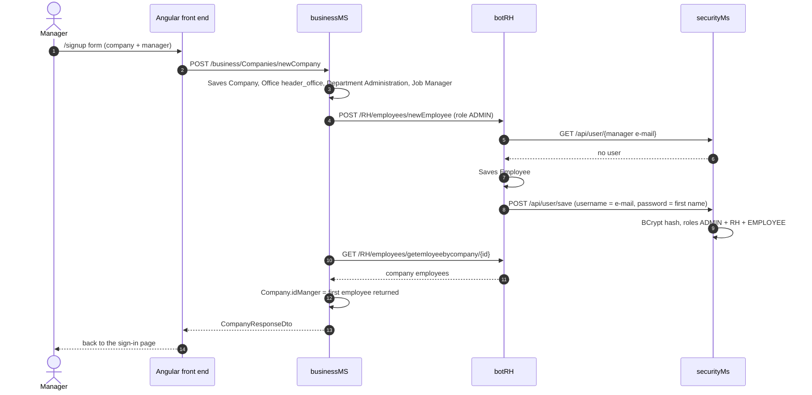
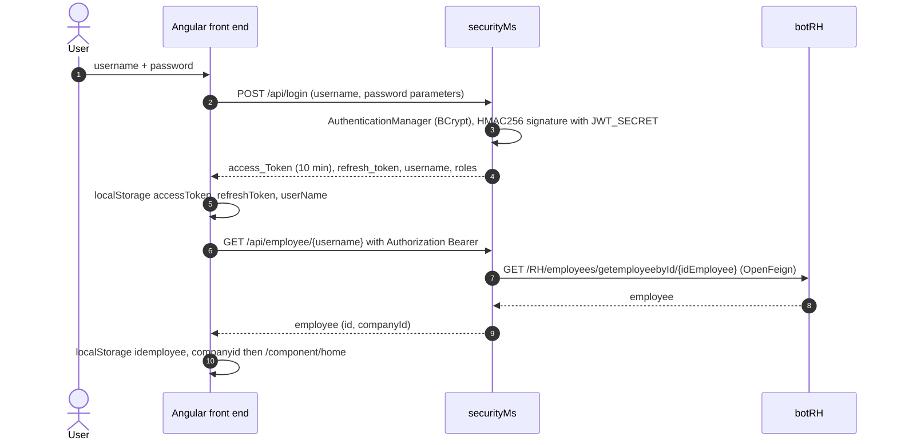

# CollaboratorBook back-end architecture

[Français](ARCHITECTURE.md) · **English**

Back to the [README](../README.en.md) · See also: [API](API.en.md) · [data model](DATA-MODEL.en.md)

## Overview

The back end consists of five independent Spring Boot 2.7.18 applications (one Maven project per folder, no parent
POM). Three business services each own a MySQL database and register with Eureka; they call each other with OpenFeign.
The overall diagram is in the Architecture section of the [README](../README.en.md#architecture).

| Module | Main class | Port | Eureka name | Database | Main dependencies |
|---|---|---|---|---|---|
| `eureka-server` | `com.ditriot.eurekaserver.EurekaServerApplication` (`@EnableEurekaServer`) | 8761 | — | — | `spring-cloud-starter-netflix-eureka-server` |
| `cloud-gateway` | `com.ditriot.cloudgateway.CloudGatewayApplication` | 8888 | `gateway-service` | — | `spring-cloud-starter-gateway`, Eureka client, actuator, `spring-webmvc` |
| `securityMs` | `com.ditriot.securityms.SecurityMsApplication` | 8087 | `security-service` | `security_db` | web, data-jpa, security, Eureka client, OpenFeign, `java-jwt`, springdoc |
| `botRH` | `com.ditriot.BotRhApplication` | 8081 | `rh-service` | `rh_db` | web, data-jpa, Eureka client, OpenFeign, MapStruct, springdoc |
| `businessMS` | `com.detiriot.businessms.BusinessMsApplication` | 8082 | `business-service` | `business_db` | web, data-jpa, Eureka client, OpenFeign, MapStruct, springdoc |

Eureka registers application names in upper case (`RH-SERVICE`, `SECURITY-SERVICE`, `BUSINESS-SERVICE`): these are the
names used by the Feign clients and by the gateway routes.

## Modules

### eureka-server

Netflix Eureka registry. `eureka.client.register-with-eureka=false` and `eureka.client.fetch-registry=false`: the server
does not register itself. Dashboard: http://localhost:8761.

### cloud-gateway

- Only the `DiscoveryClientRouteDefinitionLocator` bean is active, with
  `spring.cloud.gateway.discovery.locator.enabled=true`: a `/<EUREKA-NAME>/**` route is created for every registered
  service, and the prefix is stripped before forwarding (`/RH-SERVICE/RH/employees` → `/RH/employees` on botRH).
- Static routes (`/RH/**`, `/business/**`, `/api/**` to `lb://...`) are written in `gatewayRoutes`, but its `@Bean`
  annotation is commented out.
- Global CORS (`spring.cloud.gateway.globalcors`): origin `http://localhost:4200/`, credentials allowed, all methods
  and headers.
- **Blocking issue**: the `pom.xml` declares `org.springframework:spring-webmvc` in addition to
  `spring-cloud-starter-gateway`. Spring Cloud Gateway only runs on WebFlux and rejects Spring MVC on the classpath (check
  in `GatewayClassPathWarningAutoConfiguration`). The gateway must be fixed before use; the current front end does not
  go through it.

### securityMs

| Package | Content |
|---|---|
| `controller` | `UserController` (`/api`): users, roles, token refresh |
| `filter` | `CustomAuthenticationFilter` (handles `POST /api/login`, issues the JWTs), `CustomAuthorizationFilter` (checks the `Authorization: Bearer` header) |
| `security` | `SecurityConfig` (stateless, CSRF disabled, filters), `CORSFilter` (open CORS headers), `JwtAlgorithm` (HMAC256 from `JWT_SECRET`) |
| `model` | `User` and `Role` entities, `Employee` class (botRH response, not persisted) |
| `repo` | `UserRepo`, `RoleRepo` |
| `service` | `UserServiceImpl` (`UserService` + `UserDetailsService`, `@Transactional`), `EmployeeService` Feign client |

### botRH and businessMS

Both services share the same layering:

| Package | Content |
|---|---|
| `controller` | REST controllers (`@CrossOrigin("*")`), one per resource |
| `service` | `XxxService` interfaces and `XxxServiceImpl` implementations; Feign clients |
| `repo` | Spring Data JPA interfaces (derived queries, no `@Query`) |
| `model` | JPA entities, enums, transport classes for data owned by another service |
| `dto` | `XxxRequestDto` (input) and `XxxResponseDto` (output) |
| `mapper` | MapStruct interfaces `@Mapper(componentModel = "spring")` |

## Calls between services (OpenFeign)

| Caller | Feign client | Target | Route called | Purpose |
|---|---|---|---|---|
| botRH | `UserService` | `SECURITY-SERVICE` | `GET /api/user/{username}` | Check that no account exists before creating an employee |
| botRH | `UserService` | `SECURITY-SERVICE` | `POST /api/user/save` | Create the account of a new employee |
| botRH | `UserService` | `SECURITY-SERVICE` | `DELETE /api/user/deletebyEid/{ide}` | Delete the account of a deleted employee |
| botRH | `JobService` | `BUSINESS-SERVICE` | `GET /business/jobs/{id}` | Attach the job to an employee record |
| botRH | `JobService` | `BUSINESS-SERVICE` | `GET /business/jobs/jobsbycompany/{cid}`, `GET /business/jobs/companybyjob/{jid}` | Jobs of a company, company of a job |
| businessMS | `EmployeeService` | `RH-SERVICE` | `POST /RH/employees/newEmployee` | Create the manager during a company sign-up |
| businessMS | `EmployeeService` | `RH-SERVICE` | `GET /RH/employees/getemployeebyId/{id}`, `GET /RH/employees/getemloyeebycompany/{cId}`, `GET /RH/employees/getemployeesbyjob/{id}` | Manager record, employees of a company or a job |
| securityMs | `EmployeeService` | `RH-SERVICE` | `GET /RH/employees/getemployeebyId/{id}` | Employee linked to a user |

These calls go through Eureka and the Spring Cloud load balancer: if Eureka or the target service is down, the original
request fails.

## Main flows

### Company sign-up

`POST /business/Companies/newCompany` creates the whole initial structure and the manager's account in one go.

The `ADMIN`, `RH` and `EMPLOYEE` roles are looked up by name in `security_db` when the account is created: they must
have been created beforehand (step 4 of the README). If a Feign call fails midway, the records already saved are not
rolled back (no distributed transaction).

### Sign-in and profile loading

The refresh token (365 hours) is exchanged for a new access token on `GET /api/token/refresh`, with the
`Authorization: Bearer <refresh_token>` header; the response contains `Access_token` and `refresh_token`.

### Creating and deleting an employee

- `POST /RH/employees/newEmployee`: botRH checks that no account exists for `professionalMail`, saves the employee
  (not archived), then creates the securityMs account with the e-mail address as username, the first name as initial
  password and the employee's `role` field. If the account already exists, the response is empty and nothing is
  created.
- `DELETE /RH/employees/delete/{id}`: botRH deletes the employee, then calls `DELETE /api/user/deletebyEid/{id}`.

### Documents

1. `POST /RH/documents/newDocument` creates the record (name, `DocType`, etc.).
2. `PUT /RH/documents/uploadDocument/{id}` receives the file as multipart (`file` field, 200 MB at most) and stores it
   in the database (`@Lob`) with its MIME type and size.
3. `GET /RH/documents/download/{id}` returns the content with its MIME type.

The stored download URL is hard-coded in `DocumentServiceImpl` (`http://localhost:8081/RH/documents/download/<id>`).
The front end uses this mechanism for post images.

### Leave requests

`POST /RH/holidays/newHoliday/{idEmployee}` first recomputes the employee's balance (`leavesCalculator`: 1.8 days per
month elapsed since the start of the active contract), compares it with the requested duration, then saves the request
with the `PENDING` or `REFUSED` status, based on a check of existing leave on the employee's active projects. Approval
goes through `DELETE /RH/holidays/prouve/{id}` (`PROVED` status).

## Cross-cutting conventions

- **DTOs**: controllers take `XxxRequestDto` objects and return `XxxResponseDto` objects, converted by MapStruct.
  Links between resources are created by dedicated routes such as `PUT /.../addToXxx/{id}/{id}`.
- **Soft archiving**: `Boolean archived` field; `archive` / `noarchive` routes (`DELETE` verb in botRH, `PUT` in
  businessMS, which has no unarchive route); `active/...` and `archived/...` variants of the lists.
- **Errors**: no `@ControllerAdvice`. Services read entities with `findById(id).get()`: an unknown ID throws
  `NoSuchElementException` and results in a 500 response. Some methods return `null`, which results in a 200 response
  with an empty body.
- **Transactions**: only `UserServiceImpl` (securityMs) is `@Transactional`; elsewhere, each repository call runs in
  its own transaction.
- **Logging**: `spring.jpa.show-sql=true` in the three business services.
- **Security**: see the Security section of the [README](../README.en.md#security).
