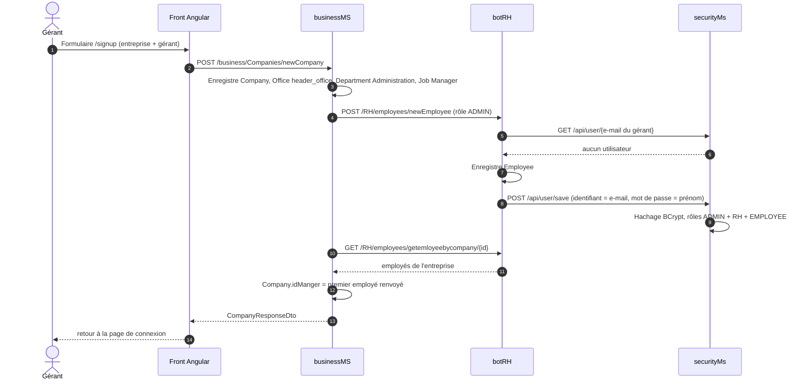
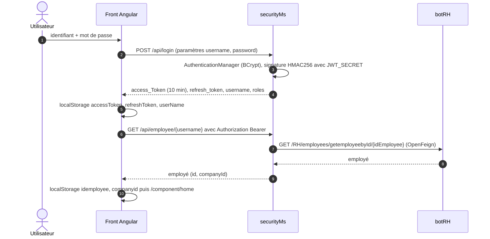

# Architecture du back-end CollaboratorBook

**Français** · [English](ARCHITECTURE.en.md)

Retour au [README](../README.md) · Voir aussi : [API](API.md) · [modèle de données](DATA-MODEL.md)

## Vue d'ensemble

Le back-end se compose de cinq applications Spring Boot 2.7.18 indépendantes (un projet Maven par dossier, sans POM
parent). Trois services métier possèdent chacun leur base MySQL et s'enregistrent dans Eureka ; ils s'appellent entre
eux avec OpenFeign. Le schéma général figure dans la section Architecture du [README](../README.md#architecture).

| Module | Classe principale | Port | Nom Eureka | Base | Dépendances principales |
|---|---|---|---|---|---|
| `eureka-server` | `com.ditriot.eurekaserver.EurekaServerApplication` (`@EnableEurekaServer`) | 8761 | — | — | `spring-cloud-starter-netflix-eureka-server` |
| `cloud-gateway` | `com.ditriot.cloudgateway.CloudGatewayApplication` | 8888 | `gateway-service` | — | `spring-cloud-starter-gateway`, client Eureka, actuator, `spring-webmvc` |
| `securityMs` | `com.ditriot.securityms.SecurityMsApplication` | 8087 | `security-service` | `security_db` | web, data-jpa, security, client Eureka, OpenFeign, `java-jwt`, springdoc |
| `botRH` | `com.ditriot.BotRhApplication` | 8081 | `rh-service` | `rh_db` | web, data-jpa, client Eureka, OpenFeign, MapStruct, springdoc |
| `businessMS` | `com.detiriot.businessms.BusinessMsApplication` | 8082 | `business-service` | `business_db` | web, data-jpa, client Eureka, OpenFeign, MapStruct, springdoc |

Eureka enregistre les noms d'application en majuscules (`RH-SERVICE`, `SECURITY-SERVICE`, `BUSINESS-SERVICE`) : ce sont
les noms utilisés par les clients Feign et par les routes de la passerelle.

## Modules

### eureka-server

Registre Netflix Eureka. `eureka.client.register-with-eureka=false` et `eureka.client.fetch-registry=false` : le serveur
ne s'enregistre pas lui-même. Tableau de bord : http://localhost:8761.

### cloud-gateway

- Seul le bean `DiscoveryClientRouteDefinitionLocator` est actif, avec
  `spring.cloud.gateway.discovery.locator.enabled=true` : une route `/<NOM-EUREKA>/**` est créée pour chaque service
  enregistré, et le préfixe est retiré avant transmission (`/RH-SERVICE/RH/employees` → `/RH/employees` sur botRH).
- Les routes statiques (`/RH/**`, `/business/**`, `/api/**` vers `lb://...`) sont écrites dans `gatewayRoutes`, mais
  son annotation `@Bean` est commentée.
- CORS global (`spring.cloud.gateway.globalcors`) : origine `http://localhost:4200/`, identifiants autorisés, toutes
  méthodes et tous en-têtes.
- **Point bloquant** : le `pom.xml` déclare `org.springframework:spring-webmvc` en plus de
  `spring-cloud-starter-gateway`. Spring Cloud Gateway fonctionne uniquement sur WebFlux et refuse Spring MVC sur le
  classpath (contrôle `GatewayClassPathWarningAutoConfiguration`). La passerelle doit être corrigée avant usage ; le
  front actuel ne passe pas par elle.

### securityMs

| Paquet | Contenu |
|---|---|
| `controller` | `UserController` (`/api`) : utilisateurs, rôles, rafraîchissement du jeton |
| `filter` | `CustomAuthenticationFilter` (traite `POST /api/login`, émet les JWT), `CustomAuthorizationFilter` (vérifie l'en-tête `Authorization: Bearer`) |
| `security` | `SecurityConfig` (sans état, CSRF désactivé, filtres), `CORSFilter` (en-têtes CORS ouverts), `JwtAlgorithm` (HMAC256 à partir de `JWT_SECRET`) |
| `model` | entités `User` et `Role`, classe `Employee` (réponse de botRH, non persistée) |
| `repo` | `UserRepo`, `RoleRepo` |
| `service` | `UserServiceImpl` (`UserService` + `UserDetailsService`, `@Transactional`), client Feign `EmployeeService` |

### botRH et businessMS

Les deux services suivent le même découpage :

| Paquet | Contenu |
|---|---|
| `controller` | contrôleurs REST (`@CrossOrigin("*")`), un par ressource |
| `service` | interfaces `XxxService` et implémentations `XxxServiceImpl` ; clients Feign |
| `repo` | interfaces Spring Data JPA (requêtes dérivées du nom des méthodes, aucune `@Query`) |
| `model` | entités JPA, énumérations, classes de transport pour les données d'un autre service |
| `dto` | `XxxRequestDto` (entrée) et `XxxResponseDto` (sortie) |
| `mapper` | interfaces MapStruct `@Mapper(componentModel = "spring")` |

## Appels entre services (OpenFeign)

| Appelant | Client Feign | Cible | Route appelée | Usage |
|---|---|---|---|---|
| botRH | `UserService` | `SECURITY-SERVICE` | `GET /api/user/{username}` | Vérifier qu'aucun compte n'existe avant de créer un employé |
| botRH | `UserService` | `SECURITY-SERVICE` | `POST /api/user/save` | Créer le compte d'un nouvel employé |
| botRH | `UserService` | `SECURITY-SERVICE` | `DELETE /api/user/deletebyEid/{ide}` | Supprimer le compte d'un employé supprimé |
| botRH | `JobService` | `BUSINESS-SERVICE` | `GET /business/jobs/{id}` | Joindre le poste à la fiche d'un employé |
| botRH | `JobService` | `BUSINESS-SERVICE` | `GET /business/jobs/jobsbycompany/{cid}`, `GET /business/jobs/companybyjob/{jid}` | Postes d'une entreprise, entreprise d'un poste |
| businessMS | `EmployeeService` | `RH-SERVICE` | `POST /RH/employees/newEmployee` | Créer le gérant lors de l'inscription d'une entreprise |
| businessMS | `EmployeeService` | `RH-SERVICE` | `GET /RH/employees/getemployeebyId/{id}`, `GET /RH/employees/getemloyeebycompany/{cId}`, `GET /RH/employees/getemployeesbyjob/{id}` | Fiche du gérant, employés d'une entreprise ou d'un poste |
| securityMs | `EmployeeService` | `RH-SERVICE` | `GET /RH/employees/getemployeebyId/{id}` | Employé lié à un utilisateur |

Ces appels passent par Eureka et le load balancer Spring Cloud : si Eureka ou le service cible est arrêté, la requête
d'origine échoue.

## Flux principaux

### Inscription d'une entreprise

`POST /business/Companies/newCompany` crée en une fois toute la structure de départ et le compte du gérant.

Les rôles `ADMIN`, `RH` et `EMPLOYEE` sont recherchés par leur nom dans `security_db` au moment de créer le compte :
ils doivent avoir été créés au préalable (étape 4 du README). Si un appel Feign échoue en cours de route, les
enregistrements déjà faits ne sont pas annulés (pas de transaction distribuée).

### Connexion et chargement du profil

Le jeton de rafraîchissement (365 heures) s'échange contre un nouveau jeton d'accès sur `GET /api/token/refresh`, avec
l'en-tête `Authorization: Bearer <refresh_token>` ; la réponse contient `Access_token` et `refresh_token`.

### Création et suppression d'un employé

- `POST /RH/employees/newEmployee` : botRH vérifie qu'aucun compte n'existe pour `professionalMail`, enregistre
  l'employé (non archivé), puis crée le compte securityMs avec l'e-mail comme identifiant, le prénom comme mot de passe
  initial et le champ `role` de l'employé. Si le compte existe déjà, la réponse est vide et rien n'est créé.
- `DELETE /RH/employees/delete/{id}` : botRH supprime l'employé puis appelle `DELETE /api/user/deletebyEid/{id}`.

### Documents

1. `POST /RH/documents/newDocument` crée la fiche (nom, type `DocType`, etc.).
2. `PUT /RH/documents/uploadDocument/{id}` reçoit le fichier en multipart (champ `file`, 200 Mo au plus) et le stocke
   en base (`@Lob`) avec son type MIME et sa taille.
3. `GET /RH/documents/download/{id}` renvoie le contenu avec son type MIME.

L'URL de téléchargement enregistrée est écrite en dur dans `DocumentServiceImpl` (`http://localhost:8081/RH/documents/download/<id>`).
Le front utilise ce mécanisme pour les images des publications.

### Demandes de congé

`POST /RH/holidays/newHoliday/{idEmployee}` recalcule d'abord le solde de l'employé (`leavesCalculator` : 1,8 jour par
mois écoulé depuis le début de son contrat actif), compare ce solde à la durée demandée, puis enregistre la demande avec
le statut `PENDING` ou `REFUSED` selon une vérification des congés existants sur les projets actifs de l'employé. La
validation se fait par `DELETE /RH/holidays/prouve/{id}` (statut `PROVED`).

## Conventions transverses

- **DTO** : les contrôleurs reçoivent des `XxxRequestDto` et renvoient des `XxxResponseDto`, convertis par MapStruct.
  Les liens entre ressources se créent par des routes dédiées du type `PUT /.../addToXxx/{id}/{id}`.
- **Archivage logique** : champ `Boolean archived` ; routes `archive` / `noarchive` (verbe `DELETE` dans botRH, `PUT`
  dans businessMS, qui n'a pas de route de désarchivage) ; variantes `active/...` et `archived/...` des listes.
- **Erreurs** : aucun `@ControllerAdvice`. Les services lisent les entités par `findById(id).get()` : un identifiant
  inconnu lève `NoSuchElementException` et produit une réponse 500. Certaines méthodes renvoient `null`, ce qui donne
  une réponse 200 au corps vide.
- **Transactions** : seul `UserServiceImpl` (securityMs) est `@Transactional` ; ailleurs, chaque appel de dépôt est
  sa propre transaction.
- **Journalisation** : `spring.jpa.show-sql=true` dans les trois services métier.
- **Sécurité** : voir la section Sécurité du [README](../README.md#sécurité).
