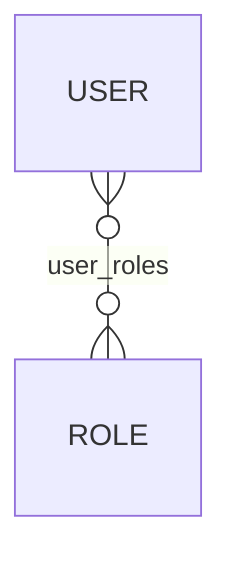
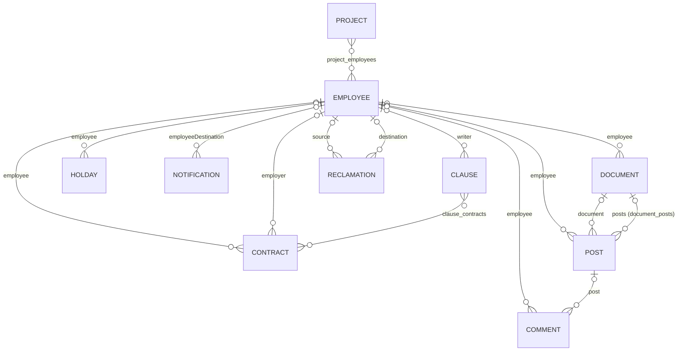
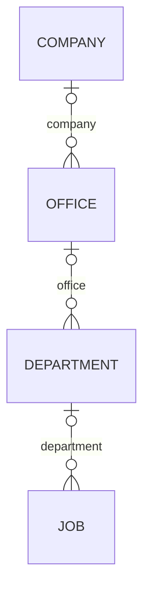

# CollaboratorBook back-end data model

[Français](DATA-MODEL.md) · **English**

Back to the [README](../README.en.md) · See also: [architecture](ARCHITECTURE.en.md) · [API](API.en.md)

## Principles

- **One MySQL database per service**: `security_db` (securityMs), `rh_db` (botRH), `business_db` (businessMS), created
  on start-up (`createDatabaseIfNotExist=true`).
- **Schema generated by Hibernate** (`spring.jpa.hibernate.ddl-auto=update`): missing tables and columns are added on
  start-up; nothing is dropped or renamed. There is no Flyway, no Liquibase and no data script.
- **Naming**: Spring Boot's default strategy. Tables and columns are in `snake_case` (`employeeDestination` →
  `employee_destination_id`); join tables are named `<owning table>_<attribute>` (`project_employees`).
- **IDs**: `Long id` with `@GeneratedValue(strategy = GenerationType.IDENTITY)` (MySQL auto-increment).
- **Enums**: stored as text (`@Enumerated(EnumType.STRING)`), except `Document.docType`, stored as an ordinal.
- **Archiving**: most entities have a `Boolean archived` field (soft archiving).

## security_db (securityMs)

| Entity (table) | Fields | Relationships |
|---|---|---|
| `User` (`user`) | `id`, `idEmployee`, `username`, `password` (BCrypt), `role` (text: `ADMIN`, `HUM_RES`, `EMPLOYEE`, `SUPER_USER`, `BOT`) | `roles`: many-to-many to `Role`, eager loading (`user_roles` table) |
| `Role` (`role`) | `id`, `name` (`ADMIN`, `RH`, `EMPLOYEE`, `SUPER_USER`, `ROBOT`) | — |

The securityMs `Employee` class is not an entity: it holds the botRH response.

## rh_db (botRH)

| Entity (table) | Main fields | Relationships |
|---|---|---|
| `Employee` (`employee`) | `firstName`, `lastName`, `cin`, `deleveryDate`, `birthDate`, `adresse`, `childNumber`, `statusF`, `personalPhone`, `personalMail`, `professionalPhone`, `professionalMail`, `leaveNumber` (leave balance), `lastDay`, `folder`, `role`, `jobId`, `companyId`, `archived` | inverse side of all the associations below; `job` and `company` are `@Transient` (filled from businessMS) |
| `Contract` (`contract`) | `startDate`, `netSalary`, `grossSalary`, `contractType`, `duration`, `archived` | `employee` and `employer` → `Employee` (lazy loading); `clauses` (inverse side of `Clause.contracts`) |
| `Clause` (`clause`) | `title`, `description`, `creationDate`, `archived` | `writer` → `Employee`; `contracts` ↔ `Contract`, many-to-many (`clause_contracts` table, `CascadeType.ALL`) |
| `Holday` (`holday`) | `startDate`, `status`, `duration` (`TypeLeave`), `archived` | `employee` → `Employee` |
| `Project` (`project`) | `name`, `description`, `client`, `startDate`, `deadLine`, `finalDate`, `idCompany`, `archived` | `employees` ↔ `Employee`, many-to-many (`project_employees` table); `company` is `@Transient` |
| `Document` (`document`) | `name`, `docType`, `fileType` (MIME type), `data` (`@Lob`, file content), `fileSize`, `downloadUrl`, `archived` | `employee` → `Employee`; `posts` → `Post`, one-to-many (`document_posts` table) |
| `Post` (`post`) | `text`, `date`, `photo` (URL), `archived` | `employee` → `Employee`; `document` → `Document`; `comments` (inverse side of `Comment.post`) |
| `Comment` (`comment`) | `text`, `date`, `archived` | `employee` → `Employee`; `post` → `Post` |
| `Notification` (`notification`) | `text`, `notificationType`, `archived` | `employeeDestination` → `Employee` |
| `Reclamation` (`reclamation`) | `subject`, `text`, `archived` | `source` and `destination` → `Employee` |
| `Statistic` (`statistic`), `StatisticYearly` (`statistic_yearly`) | date (`statDate`, `statYear`) and `Long` counters (`allEmployees`, `allPosts`, `allArchivedClaims`, `toDayPosts`…) | none |

The `Company`, `Job` and `User` classes in the botRH `model` package are not entities: they carry data read from the
other services.

## business_db (businessMS)

| Entity (table) | Fields | Relationships |
|---|---|---|
| `Company` (`company`) | `name`, `mobile`, `phone`, `fax`, `address`, `email`, `managerFirstName`, `managerLastName`, `managerPhoneNumber`, `managerEmail`, `idManger`, `archived` | `offices` (inverse side of `Office.company`, `CascadeType.ALL`) |
| `Office` (`office`) | `name`, `mobile`, `phone`, `fax`, `address`, `email`, `archived` | `company` → `Company`; `departments` (inverse side, `CascadeType.ALL`) |
| `Department` (`department`) | `name`, `archived` | `office` → `Office`; `jobs` (inverse side, `CascadeType.ALL`) |
| `Job` (`job`) | `name`, `description`, `companyId`, `archived` | `department` → `Department`; `departmentResponseDto` is `@Transient` |

The businessMS `Employee` class is not an entity: it is used for the calls to botRH.

## Enums (botRH)

| Enum | Values | Field |
|---|---|---|
| `ContractType` | `CDI`, `CDD`, `CIVP`, `INTERSHIP` | `Contract.contractType` |
| `Duration` | `ONE_MONTH`, `TWO_MONTHS`, `THREE_MONTHS`, `SIX_MONTHS`, `ONE_YEAR`, `OTHER`, `UNLIMITED` | `Contract.duration` |
| `TypeLeave` | `HALF_DAY`, `ONE_DAY`, `TWO_DAYS`, `THREE_DAYS` | `Holday.duration` |
| `Status` | `PROVED`, `REFUSED`, `PENDING` | `Holday.status` |
| `StatusF` | `MARRIED`, `SINGLE`, `DIVORCED`, `WIDOW` | `Employee.statusF` (marital status) |
| `Role` | `ADMIN`, `SUPER_USER`, `EMPLOYEE`, `HUM_RES`, `BOT` | `Employee.role` |
| `NotificationType` | `ALERT`, `INFO`, `IMPORTANT`, `REMEMBER` | `Notification.notificationType` |
| `DocType` | `CIN`, `RIB`, `DIPLOMAT`, `CONTRACT`, `CNSS`, `PROFIL_IMG`, `POST_IMG` | `Document.docType` (ordinal) |

## References between services

These columns hold the ID of a row owned by another service; no foreign key enforces them.

| Column | Database | Refers to |
|---|---|---|
| `user.id_employee` | `security_db` | `employee.id` (`rh_db`) |
| `employee.job_id` | `rh_db` | `job.id` (`business_db`) |
| `employee.company_id` | `rh_db` | `company.id` (`business_db`) |
| `project.id_company` | `rh_db` | `company.id` (`business_db`) |
| `company.id_manger` | `business_db` | `employee.id` (`rh_db`) |
| `job.company_id` | `business_db` | `company.id` (same database, no foreign key) |

## Notes

- `Employee.comments` is declared `@OneToMany(mappedBy = "post")`: it relies on the comments' `post_id` column, not on
  their author (`employee_id`).
- `Document.docType` has no `@Enumerated`: changing the order of the `DocType` values would change the meaning of the
  stored data.
- `Document.posts` (`document_posts` table) and `Post.document` (`document_id` column) are two independent
  associations.
- The `statistic` and `statistic_yearly` tables stay empty: `StatisticServiceImpl.createDailyStat()` is never called.
- The `role` table has no uniqueness constraint on `name`.
