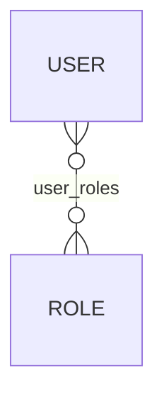
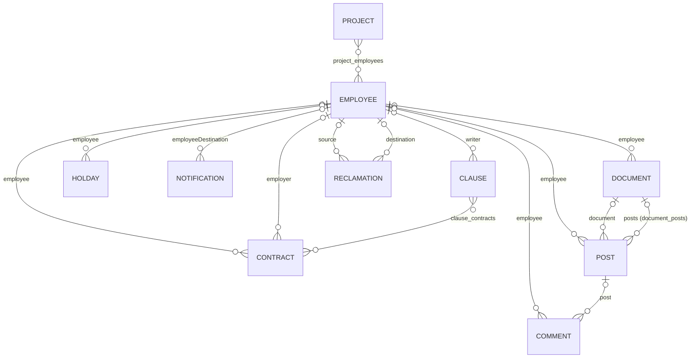
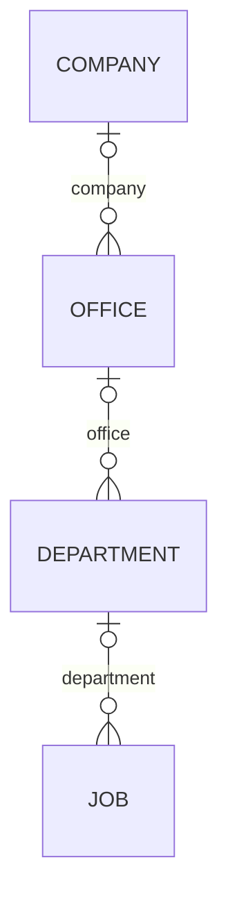

# Modèle de données du back-end CollaboratorBook

**Français** · [English](DATA-MODEL.en.md)

Retour au [README](../README.md) · Voir aussi : [architecture](ARCHITECTURE.md) · [API](API.md)

## Principes

- **Une base MySQL par service** : `security_db` (securityMs), `rh_db` (botRH), `business_db` (businessMS), créées au
  démarrage (`createDatabaseIfNotExist=true`).
- **Schéma généré par Hibernate** (`spring.jpa.hibernate.ddl-auto=update`) : les tables et colonnes manquantes sont
  ajoutées au démarrage ; rien n'est supprimé ni renommé. Il n'y a ni Flyway ni Liquibase, ni script de données.
- **Nommage** : stratégie par défaut de Spring Boot. Les tables et colonnes sont en `snake_case` (`employeeDestination`
  → `employee_destination_id`) ; les tables de jointure sont nommées `<table propriétaire>_<attribut>`
  (`project_employees`).
- **Identifiants** : `Long id` avec `@GeneratedValue(strategy = GenerationType.IDENTITY)` (auto-incrément MySQL).
- **Énumérations** : stockées sous forme de texte (`@Enumerated(EnumType.STRING)`), sauf `Document.docType`, stockée en
  ordinal.
- **Archivage** : la plupart des entités ont un champ `Boolean archived` (archivage logique).

## security_db (securityMs)

| Entité (table) | Champs | Relations |
|---|---|---|
| `User` (`user`) | `id`, `idEmployee`, `username`, `password` (BCrypt), `role` (texte : `ADMIN`, `HUM_RES`, `EMPLOYEE`, `SUPER_USER`, `BOT`) | `roles` : plusieurs-à-plusieurs vers `Role`, chargement immédiat (table `user_roles`) |
| `Role` (`role`) | `id`, `name` (`ADMIN`, `RH`, `EMPLOYEE`, `SUPER_USER`, `ROBOT`) | — |

La classe `Employee` de securityMs n'est pas une entité : elle reçoit la réponse de botRH.

## rh_db (botRH)

| Entité (table) | Champs principaux | Relations |
|---|---|---|
| `Employee` (`employee`) | `firstName`, `lastName`, `cin`, `deleveryDate`, `birthDate`, `adresse`, `childNumber`, `statusF`, `personalPhone`, `personalMail`, `professionalPhone`, `professionalMail`, `leaveNumber` (solde de congés), `lastDay`, `folder`, `role`, `jobId`, `companyId`, `archived` | côté inverse de toutes les associations ci-dessous ; `job` et `company` sont `@Transient` (remplis depuis businessMS) |
| `Contract` (`contract`) | `startDate`, `netSalary`, `grossSalary`, `contractType`, `duration`, `archived` | `employee` et `employer` → `Employee` (chargement différé) ; `clauses` (côté inverse de `Clause.contracts`) |
| `Clause` (`clause`) | `title`, `description`, `creationDate`, `archived` | `writer` → `Employee` ; `contracts` ↔ `Contract`, plusieurs-à-plusieurs (table `clause_contracts`, `CascadeType.ALL`) |
| `Holday` (`holday`) | `startDate`, `status`, `duration` (`TypeLeave`), `archived` | `employee` → `Employee` |
| `Project` (`project`) | `name`, `description`, `client`, `startDate`, `deadLine`, `finalDate`, `idCompany`, `archived` | `employees` ↔ `Employee`, plusieurs-à-plusieurs (table `project_employees`) ; `company` est `@Transient` |
| `Document` (`document`) | `name`, `docType`, `fileType` (type MIME), `data` (`@Lob`, contenu du fichier), `fileSize`, `downloadUrl`, `archived` | `employee` → `Employee` ; `posts` → `Post`, un-à-plusieurs (table `document_posts`) |
| `Post` (`post`) | `text`, `date`, `photo` (URL), `archived` | `employee` → `Employee` ; `document` → `Document` ; `comments` (côté inverse de `Comment.post`) |
| `Comment` (`comment`) | `text`, `date`, `archived` | `employee` → `Employee` ; `post` → `Post` |
| `Notification` (`notification`) | `text`, `notificationType`, `archived` | `employeeDestination` → `Employee` |
| `Reclamation` (`reclamation`) | `subject`, `text`, `archived` | `source` et `destination` → `Employee` |
| `Statistic` (`statistic`), `StatisticYearly` (`statistic_yearly`) | date (`statDate`, `statYear`) et compteurs `Long` (`allEmployees`, `allPosts`, `allArchivedClaims`, `toDayPosts`…) | aucune |

Les classes `Company`, `Job` et `User` du paquet `model` de botRH ne sont pas des entités : elles transportent les
données lues dans les autres services.

## business_db (businessMS)

| Entité (table) | Champs | Relations |
|---|---|---|
| `Company` (`company`) | `name`, `mobile`, `phone`, `fax`, `address`, `email`, `managerFirstName`, `managerLastName`, `managerPhoneNumber`, `managerEmail`, `idManger`, `archived` | `offices` (côté inverse de `Office.company`, `CascadeType.ALL`) |
| `Office` (`office`) | `name`, `mobile`, `phone`, `fax`, `address`, `email`, `archived` | `company` → `Company` ; `departments` (côté inverse, `CascadeType.ALL`) |
| `Department` (`department`) | `name`, `archived` | `office` → `Office` ; `jobs` (côté inverse, `CascadeType.ALL`) |
| `Job` (`job`) | `name`, `description`, `companyId`, `archived` | `department` → `Department` ; `departmentResponseDto` est `@Transient` |

La classe `Employee` de businessMS n'est pas une entité : elle sert aux appels vers botRH.

## Énumérations (botRH)

| Énumération | Valeurs | Champ |
|---|---|---|
| `ContractType` | `CDI`, `CDD`, `CIVP`, `INTERSHIP` | `Contract.contractType` |
| `Duration` | `ONE_MONTH`, `TWO_MONTHS`, `THREE_MONTHS`, `SIX_MONTHS`, `ONE_YEAR`, `OTHER`, `UNLIMITED` | `Contract.duration` |
| `TypeLeave` | `HALF_DAY`, `ONE_DAY`, `TWO_DAYS`, `THREE_DAYS` | `Holday.duration` |
| `Status` | `PROVED`, `REFUSED`, `PENDING` | `Holday.status` |
| `StatusF` | `MARRIED`, `SINGLE`, `DIVORCED`, `WIDOW` | `Employee.statusF` (situation familiale) |
| `Role` | `ADMIN`, `SUPER_USER`, `EMPLOYEE`, `HUM_RES`, `BOT` | `Employee.role` |
| `NotificationType` | `ALERT`, `INFO`, `IMPORTANT`, `REMEMBER` | `Notification.notificationType` |
| `DocType` | `CIN`, `RIB`, `DIPLOMAT`, `CONTRACT`, `CNSS`, `PROFIL_IMG`, `POST_IMG` | `Document.docType` (ordinal) |

## Références entre services

Ces colonnes contiennent l'identifiant d'une ligne d'un autre service ; aucune clé étrangère ne les contrôle.

| Colonne | Base | Désigne |
|---|---|---|
| `user.id_employee` | `security_db` | `employee.id` (`rh_db`) |
| `employee.job_id` | `rh_db` | `job.id` (`business_db`) |
| `employee.company_id` | `rh_db` | `company.id` (`business_db`) |
| `project.id_company` | `rh_db` | `company.id` (`business_db`) |
| `company.id_manger` | `business_db` | `employee.id` (`rh_db`) |
| `job.company_id` | `business_db` | `company.id` (même base, sans clé étrangère) |

## Remarques

- `Employee.comments` est déclaré `@OneToMany(mappedBy = "post")` : il s'appuie sur la colonne `post_id` des
  commentaires, et non sur leur auteur (`employee_id`).
- `Document.docType` n'a pas d'`@Enumerated` : changer l'ordre des valeurs de `DocType` modifierait le sens des données
  enregistrées.
- `Document.posts` (table `document_posts`) et `Post.document` (colonne `document_id`) sont deux associations
  indépendantes.
- Les tables `statistic` et `statistic_yearly` restent vides : `StatisticServiceImpl.createDailyStat()` n'est appelée
  nulle part.
- La table `role` n'a pas de contrainte d'unicité sur `name`.
